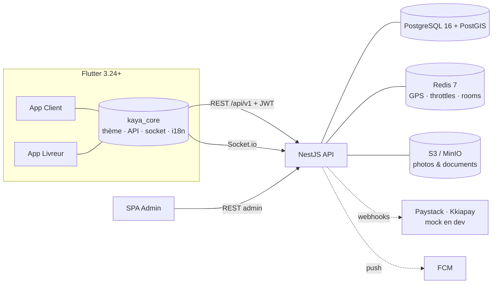

# Kaya — plateforme de livraison à la demande (Afrique de l'Ouest)

Mise en relation clients ↔ livreurs indépendants au **Ghana, Togo et Bénin** :
enchères inversées, paiement séquestre mobile money, commission dégressive,
suivi GPS temps réel, chat intégré, conformité locale (PCSRC / carte pro / permis livreur).

> « Kaya » est le nom de travail (le nom final n'est pas choisi). Voir `BLUEPRINT.md`
> pour le scope, les décisions et les jalons ; `docs/SECURITY_AUDIT.md` pour l'audit.

## Architecture



Monorepo :

| Dossier | Contenu |
|---|---|
| `backend/` | API NestJS 10 + Prisma (auth OTP/JWT, commandes, enchères, escrow, commission, litiges, admin) |
| `packages/kaya_core/` | Package Flutter partagé (design system « Accra Minimalist Delivery », modèles, Dio, Socket.io, i18n FR/EN) |
| `apps/client/` · `apps/driver/` | Les deux apps mobiles mono-rôle (Riverpod, go_router) |
| `admin/` | SPA admin minimale (statique) |
| `docs/` | Doc d'architecture, référence design, audit sécurité, OpenAPI |

## Démarrage développement

Prérequis : Node 20, Flutter ≥ 3.22, Docker Desktop.

```bash
# 1. Infrastructure (PostGIS + Redis + MinIO)
docker compose up -d

# 2. Backend
cd backend
npm ci
npx tsx scripts/generate-keys.ts     # clés JWT RS256 de dev -> ./keys (gitignoré)
cp .env.example .env                 # défauts dev prêts à l'emploi
npx prisma migrate dev
npm run db:seed                      # country_configs GHA/TGO/BEN + admin
npm run start:dev                    # API sur :3000, Swagger sur /docs

# 3. Apps mobiles (autre terminal)
cd apps/client   # ou apps/driver
flutter pub get
flutter run --dart-define=API_BASE_URL=http://10.0.2.2:3000   # émulateur Android
# iOS/simulateur : http://localhost:3000 · Maps réels : --dart-define=MAPS_API_KEY=...
```

Paiement en dev : gateway **mock** (aucune clé requise) —
`POST /api/v1/payments/mock/complete/:reference` simule le paiement (désactivé en production).

## Variables d'environnement

`backend/.env.example` est exhaustif et commenté — groupes principaux :

| Groupe | Variables clés | Notes |
|---|---|---|
| App | `NODE_ENV`, `PORT`, `APP_NAME` | `production` durcit mock/paiement & CORS |
| Données | `DATABASE_URL`, `REDIS_URL` | PostGIS requis |
| JWT | `JWT_PRIVATE_KEY`, `JWT_PUBLIC_KEY`, `JWT_ACCESS_TTL`, `JWT_REFRESH_TTL`, `JWT_ISSUER`, `JWT_AUDIENCE` | RS256 ; chemin de fichier ou PEM inline |
| HTTP | `CORS_ORIGINS`, `THROTTLE_TTL`, `THROTTLE_LIMIT` | whitelist obligatoire en prod (HTTP **et** Socket.io) |
| Stockage | `S3_ENDPOINT`, `S3_REGION`, `S3_ACCESS_KEY`, `S3_SECRET_KEY`, `S3_BUCKET`, `S3_PUBLIC_URL`, `S3_FORCE_PATH_STYLE`, `UPLOAD_MAX_BYTES` | MinIO en dev, R2/S3 en prod |
| OTP | `OTP_PROVIDER`, `OTP_LENGTH`, `OTP_TTL_MIN`, `OTP_SEND_MAX`, `OTP_SEND_WINDOW_MIN` | provider `dev` = code en console |
| Métier | `OFFER_TTL_MIN`, tarifs par pays en DB (`country_configs`) | modifiables via l'API admin |
| Intégrations | `GOOGLE_MAPS_API_KEY`, `PAYSTACK_SECRET_KEY`, `KKIAPAY_SECRET_KEY`, `FIREBASE_SERVICE_ACCOUNT` | absentes ⇒ fallbacks/mocks de dev |

## Tests & CI

```bash
cd backend && npm test          # 77 tests unitaires + e2e (e2e auto-skippés sans DB)
cd packages/kaya_core && flutter test
cd apps/client && flutter test  # idem apps/driver
```

CI GitHub Actions : `.github/workflows/ci.yml` (backend : prisma validate + lint +
build + test · flutter : analyze + test sur les 3 paquets).

## Production

- Image : `backend/Dockerfile` (multi-stage, non-root, HEALTHCHECK `/health`).
- Orchestration : `docker-compose.prod.yml` (MinIO optionnel via `--profile minio`).
- Migrations : `npx prisma migrate deploy` au déploiement, **avant** de basculer le
  trafic ; rollback = redéployer l'image précédente (les migrations sont additives ;
  ne jamais `migrate reset` en prod).
- Secrets par variables d'environnement / secret manager — jamais dans l'image.
- Rotation des clés JWT : publier la nouvelle clé publique, accepter les deux le temps
  du TTL refresh (7 j), puis retirer l'ancienne.
- Checklist complète avant mise en ligne : `docs/SECURITY_AUDIT.md` (§ Actions utilisateur).
